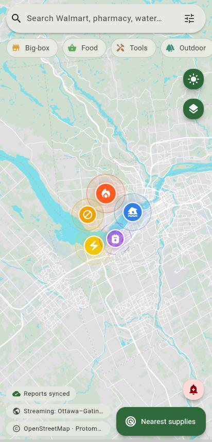
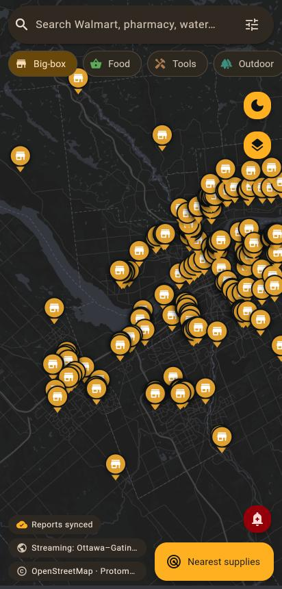
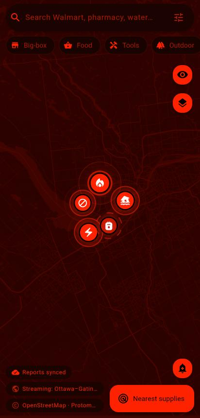
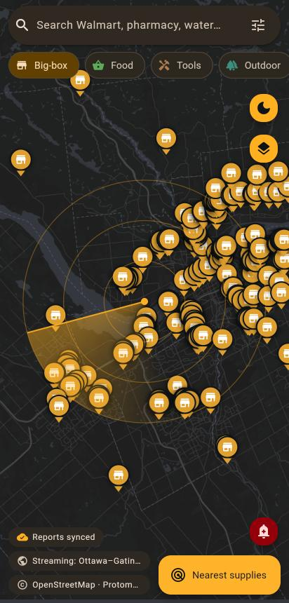
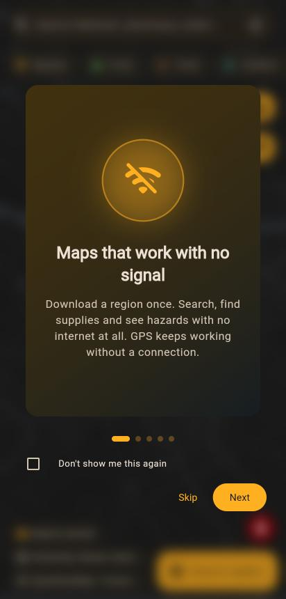
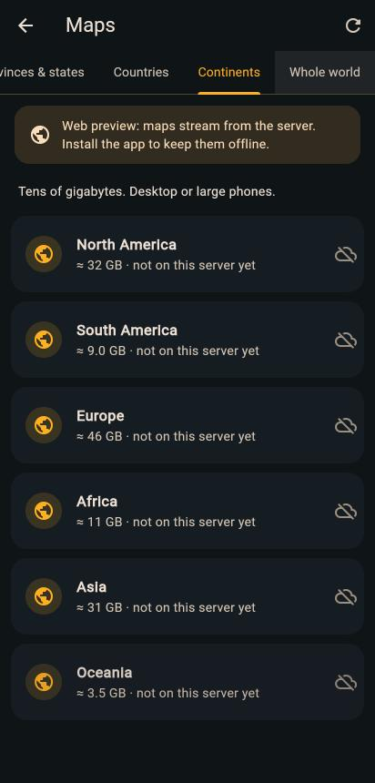
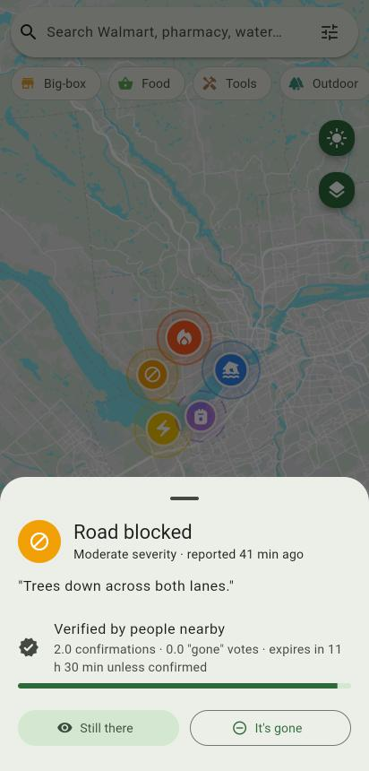

# Holdfast

**An offline survival map for emergencies.** Holdfast shows where to find food, water, tools, medicine, fuel and shelter, lets people flag hazards that the community verifies, and keeps working when the network doesn't.

Built with **Flutter** (one codebase for Android, iOS, Windows, macOS, Linux and web), a small **Go** sync server, and **PostGIS**. Map data comes from **OpenStreetMap**, packaged as **PMTiles** regions.

<p align="center">
  
  
  
  
</p>

## What it does

| | |
|---|---|
| **Offline maps, any size** | Download a city (Ottawa is 21 MB), any of 65 provinces and states, a country, a continent or the entire planet. Search the list; sizes are measured, not guessed. A region the server doesn't host yet is built on request. Downloads resume after interruption. |
| **Supplies by category** | Big-box stores, groceries, hardware, outdoor, medical, drinking water, fuel, shelters and airports: 3,508 places for Ottawa alone, all searchable offline. Star places and save searches. |
| **Offline directions** | Walk, bike, drive or take the train, computed on the device from the downloaded road and rail network, with step-by-step street names. Routes keep clear of reported hazards. |
| **Nearest supplies** | A radar sweep finds the closest place of each kind. |
| **Community hazards** | Long-press to report a fire, flood, blocked road or gas leak. A report is shown to everyone once people nearby confirm it, and expires when nobody does. |
| **Place an incident anywhere** | Put a detonation, chemical or radioactive leak, volcanic eruption or tsunami under a pin, by moving the map or typing a street, crossing or address, and see its plume, danger zone or wave arrival rings before reporting it. Airports a hazard would likely close are flagged. |
| **Hazards that move** | Wind streaks, drifting chemical puffs, radioactive sparks, lead dust, ash and smoke, tsunami fronts and an erupting vent animate over the plumes. |
| **Readings and real events** | Soil and radiation readings graded against EPA and Chernobyl-zone levels, with an estimated contamination zone. Real events, like the 2026 Iowa lead azide detonation, carry a link to their official source. |
| **Phone and PC alike** | The Windows app has everything the phone app has: Windows location, right-click for long-press, and keyboard shortcuts (Ctrl+F, +/−, L, R). |
| **Three palettes + system** | Light for sunlight, dark for dusk, and **night vision**: pure red on black, which preserves dark-adapted eyes. Switching plays a circular reveal. |
| **Battery saver** | One switch turns off every decorative animation. The OS "reduce motion" setting is honoured too. |

<p align="center">
  
  
  
</p>

## Architecture

```
┌─────────────── Flutter app ───────────────┐        ┌──────── Go server ────────┐
│ flutter_map + vector_map_tiles (PMTiles)  │  HTTP  │ POST/GET /v1/events       │
│ PoiIndex: offline search & nearest        │◄──────►│   append-only event log   │
│ HazardRepository: local event log+outbox  │ Range  │ GET /regions/* (Range)    │
│ hazard_engine.dart: the shared rules      │        │ Memory store │ PostGIS    │
└───────────────────────────────────────────┘        └───────────────────────────┘
          ▲ future: the same events over Bluetooth mesh and LoRa radio (#9, #10)
```

Design decisions worth reading:

- **Hazards sync as facts, not state.** Every report and vote is an immutable event with a UUID. Folding the log is order-independent and idempotent, so events can arrive late, twice or out of order, over the internet today and over mesh radio later. See [`hazard_events.dart`](lib/hazards/hazard_events.dart).
- **The verification rules run on the client.** The server is a relay; it never decides what is "verified". Two phones with no server in reach still reach the same answer from the same facts. See [`hazard_engine.dart`](lib/hazards/hazard_engine.dart) and the discussion in #2.
- **One rendering path for every platform.** `maplibre_gl` has no desktop support, so the map is pure Dart (`flutter_map`) reading PMTiles from a local file or over HTTP range requests (#5).
- **Directions run on the device.** `tool/build_routing.py` compiles a city's roads, paths and rail lines into a varint-packed graph (Ottawa: 400,000 edges in 7.4 MB), with per-mode access, one-way rules and speeds. The app runs A* over it with hazard areas blocked; a train trip is walk → rail → walk, with estimated times because no timetables exist offline. See [`router.dart`](lib/routing/router.dart).
- **Night vision is generated, not hand-drawn.** The dark map style is walked recursively and every colour is mapped to a red of the same luminance. A test asserts that no blue light survives. See [`basemap_style.dart`](lib/map/basemap_style.dart).

## Run it locally

Requirements: Flutter 3.50+, Go 1.26+, Python 3.10+.

```sh
# 1. Fetch a region: basemap (~21 MB), supply locations and routing network
#    (or skip this: the server builds any region on demand)
python tool/fetch_region.py ottawa
python tool/import_pois.py ottawa
python tool/build_routing.py ottawa

# 2. Start the server (in-memory store; serves regions/ with Range support)
go -C server run .

# 3. Run the app
flutter run -d chrome          # web preview: streams the map from the server
flutter run -d windows         # desktop: downloads maps for offline use
flutter run -d emulator-5554 --dart-define=HOLDFAST_SERVER=http://10.0.2.2:8787
```

For a production-like backend with PostgreSQL + PostGIS: `docker compose -f server/docker-compose.yml up`.

**Offline positioning by cell towers.** When GPS can't get a fix, Holdfast places the phone using the towers it hears and a per-region tower pack. The server builds these packs from [OpenCelliD](https://opencellid.org) once you set `OPENCELLID_TOKEN` (a free token from opencellid.org); without it, the step is skipped. To build one by hand: `OPENCELLID_TOKEN=... python tool/build_cells.py ottawa`, or `python tool/build_cells.py ottawa --csv 302.csv.gz` from a file you downloaded.

## Tests

```sh
flutter analyze && flutter test   # rules, sync fold, search, routing, styles, onboarding
go -C server vet ./... && go -C server test ./...
```

## Project status

The MVP milestone covers offline maps, supplies, hazards and sync. Next up (see [issues](https://github.com/Relatora/holdfast/issues)): GPS-based "nearest" (#11), Meshtastic LoRa sync (#9), phone-to-phone mesh (#10), signed events (#14) and official alert feeds (#16). The product thinking behind all of it is in [`docs/PRODUCT.md`](docs/PRODUCT.md).

## Data and licences

Code: MIT. Map data © [OpenStreetMap](https://www.openstreetmap.org/copyright) contributors, ODbL 1.0; the supply packs are derived databases under the same licence. Basemap tiles and styles by [Protomaps](https://protomaps.com). Cell-tower positions from [OpenCelliD](https://opencellid.org), CC BY-SA 4.0. Online address search by [Photon](https://photon.komoot.io) (Komoot), from OpenStreetMap data. Weather from [Open-Meteo](https://open-meteo.com), CC BY 4.0. Hazard reports come from users and can be wrong: always follow local authorities.
